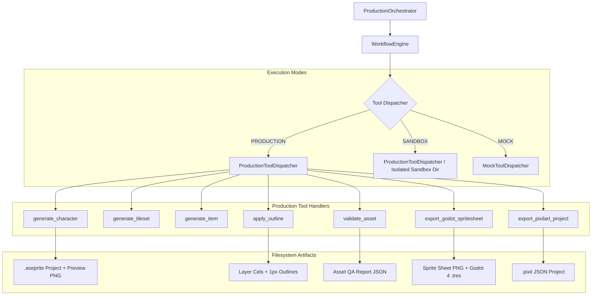

# Production Tool Binding Architecture

## 1. Overview & Core Philosophy

In Sprint 0.8, the LibreSprite Game MCP transitioned from a mock-default development layer to an **enforced production-first tool execution architecture**. 

Prior sprints permitted mock dispatchers by default, allowing workflows to claim success without generating real assets on disk. The production tool binding subsystem enforces:
1. **Real Tool Binding**: Every MCP tool call in production mode executes genuine Python image generators, Aseprite binary operations, QA validators, or engine exporters.
2. **Fail-Closed Allowlist Contracts**: Only explicitly registered, security-reviewed tools with typed parameter contracts are permitted to execute. Unregistered tools immediately raise `ToolExecutionError`.
3. **Execution Mode Isolation**: Strict boundary separation between `PRODUCTION`, `SANDBOX`, `MOCK`, and `LIVE_RUNTIME`.
4. **Filesystem Workspace Sandbox**: All file input and output paths are strictly resolved within approved workspace directories via `workspace_policy`.

---

## 2. Architecture & Components



### 2.1 ToolContract Registry

Each tool is declared with a formal `ToolContract`:
- **`tool_name`**: Unique string identifier matching the MCP tool schema.
- **`required_parameters`**: Set of mandatory keys that must be supplied by the user or predecessor steps.
- **`optional_parameters`**: Set of recognized optional parameters with default values.
- **`expected_outputs`**: Set of guaranteed output keys returned upon successful execution.
- **`handler`**: Python callable executing the native generator or processor.

### Registered Production Tool Contracts

| Tool Name | Required Parameters | Optional Parameters | Generated Outputs |
| :--- | :--- | :--- | :--- |
| `generate_character` | `character_id` | `name`, `size`, `proportion`, `palette_name` | `project_path`, `preview_path`, `character_id`, `width`, `height`, `frames` |
| `generate_tileset` | `tileset_id` | `tile_size`, `theme_name` | `tileset_path`, `tile_size`, `width`, `height` |
| `generate_item` | `item_id`, `item_type` | `size`, `palette_name` | `item_path`, `preview_path`, `item_id`, `item_type` |
| `apply_outline` | `project_path` / `input_file` | `mode`, `outline_color`, `diagonal` | `project_path`, `outline_applied`, `mode` |
| `validate_asset` | `project_path` / `input_file` | `expected_size`, `palette_name`, `max_colors` | `asset_name`, `passed`, `checks`, `critical_errors`, `warnings`, `ready_for_export`, `project_path`, `input_file` |
| `export_godot_spritesheet` | `project_path` / `input_file` | `fps`, `padding` | `sheet_png`, `tres_file`, `exported`, `target_engine` |
| `export_pixilart_project` | `project_path` / `input_file` | `title`, `fps` | `saved_path`, `project_path`, `format`, `exported` |

---

## 3. Strict Parameter & Output Validation

When `dispatch(tool_name, params, workspace)` is called:
1. **Tool Verification**: Checks if `tool_name` exists in `_contracts`. If not, raises `ToolExecutionError`.
2. **Workspace Resolution**: Ensures `workspace` exists and is validated through `workspace_policy`.
3. **Required Parameter Enforcement**: Validates that all mandatory fields are present in `params`. If any are missing, raises `ToolExecutionError`.
4. **Handler Execution**: Invokes the real handler inside a defensive try/except block. Any unhandled exception is wrapped in `ToolExecutionError` with context details.
5. **Output Verification**: Verifies that the returned dictionary contains the expected output keys.

---

## 4. Execution Mode Separation

```python
class ExecutionMode(str, Enum):
    PRODUCTION = "PRODUCTION"      # Real tools, approved skills only, production workspace
    SANDBOX = "SANDBOX"            # Real tools, isolated sandbox workspace, allows DRAFT/SANDBOX skills
    MOCK = "MOCK"                  # Fast synthetic responses for unit testing only
    LIVE_RUNTIME = "LIVE_RUNTIME"  # Interacts with live LibreSprite UI via HTTP bridge
```

- In `PRODUCTION` mode, only `SkillStatus.APPROVED` skills may be executed. Attempts to run `DRAFT` or `SANDBOX` skills raise `ValueError`.
- In `SANDBOX` mode, candidate skills in `DRAFT` or `SANDBOX` are evaluated in isolated directories (`data/sandbox_workspaces/<skill_id>/<version>/<run_id>/`).
- In `MOCK` mode, `MockToolDispatcher` generates synthetic responses for rapid unit testing without filesystem overhead.
