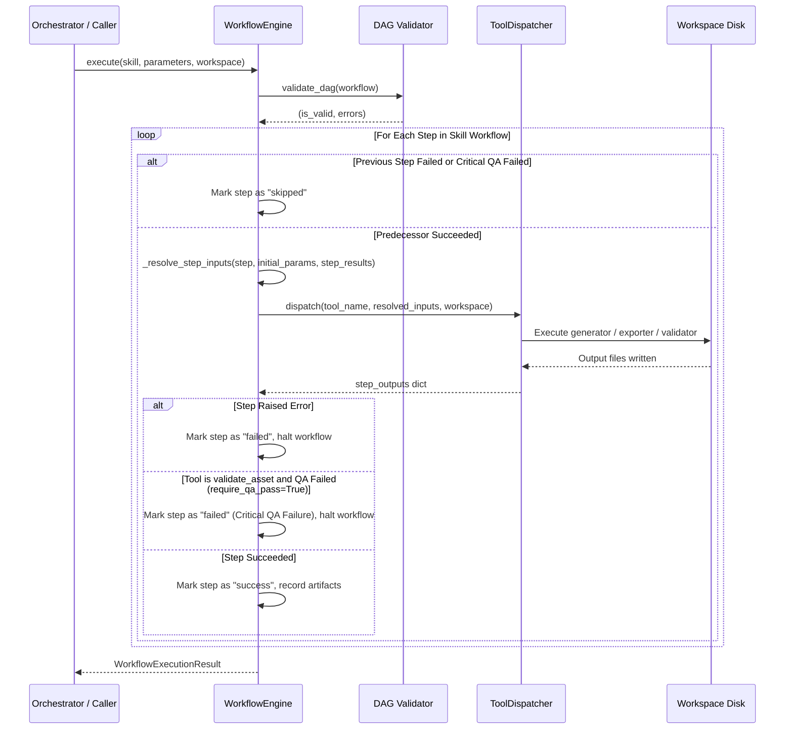

# Workflow Execution Engine Architecture

## 1. Overview & Objectives

The `WorkflowEngine` provides deterministic, DAG-validated execution of multi-step production pipelines in LibreSprite Game MCP. 

Prior to Sprint 0.8, workflow execution relied on disconnected script loops with loose parameter passing, leading to silent failures, skipped validations, and broken pipeline bindings. The new engine establishes:
1. **Deterministic DAG Validation**: Prior to execution, workflows are verified for unique step IDs, non-cyclical dependency ordering, and valid tool contracts.
2. **Dynamic Artifact Binding**: Automatically binds preceding step outputs (such as `project_path`, `preview_path`, and `saved_path`) into downstream tool inputs based on declared `source_step` references with backwards-traversal fallback.
3. **Strict Halt-on-Failure Policy**: If any step encounters an execution error, the engine immediately halts, marks all remaining steps as `skipped`, and flags the workflow as `FAILED`.
4. **Automated QA Gate Enforcement**: If `require_qa_pass` is enabled in skill validation rules, any critical QA failure immediately halts execution before export tools (such as Godot or Pixilart exporters) can run.
5. **Comprehensive Telemetry**: Produces structured `StepResult` and `WorkflowExecutionResult` objects capturing durations, inputs, outputs, errors, and generated artifacts.

---

## 2. Execution Pipeline & Data Flow



---

## 3. Dependency Binding & Artifact Resolution

A recurring production challenge in pipeline engineering is ensuring downstream tools receive the exact filesystem paths generated by earlier steps without hardcoded paths.

### 3.1 `source_step` Parameter Binding
When a workflow step specifies `"source_step": "<predecessor_step_id>"`, the engine queries `step_results[source_step_id].outputs` and binds primary artifact path keys:
- `project_path` (Aseprite project file)
- `input_file` (generic input file path)
- `saved_path` (exported project file, e.g. `.pixil`)
- `sheet_png` (rendered sprite sheet image)

### 3.2 Backwards-Traversal Fallback
If an intermediate step (such as an asset validator) does not generate a new project path, or if `source_step` was omitted in a linear pipeline, `_resolve_step_inputs()` traverses preceding steps in reverse chronological order:
```python
if "project_path" not in resolved and "input_file" not in resolved and step_results:
    for prev_res in reversed(list(step_results.values())):
        for path_key in ("project_path", "saved_path", "sheet_png"):
            if path_key in prev_res.outputs and prev_res.outputs[path_key]:
                resolved["project_path"] = prev_res.outputs[path_key]
                resolved["input_file"] = prev_res.outputs[path_key]
                break
        if "project_path" in resolved:
            break
```
This guarantees that exporter steps always receive the valid project file path even when preceded by validation or outline passes.

---

## 4. Halt-on-Failure and QA Enforcement

### 4.1 Step Execution Error
When a tool raises an unhandled exception or `ToolExecutionError`:
- Step status is set to `"failed"`.
- Step duration and error message are recorded.
- `halted = True`.
- `final_status = WorkflowStatus.FAILED`.
- All subsequent steps are immediately marked as `"skipped"` with `duration_ms = 0.0`.

### 4.2 Critical QA Gate
When `validate_asset` is invoked:
- The output report is evaluated against `skill.validation_rules.get("require_qa_pass", True)`.
- If `outputs.get("passed") is False`:
  - Step status is marked as `"failed"`.
  - Error is logged: `"Asset QA validation checks failed with critical errors: [...]"`.
  - Workflow halts immediately, preventing defective assets from reaching Godot engine exports or community formats.

---

## 5. Telemetry Schema

### `StepResult`
- `step_id: str`
- `tool_name: str`
- `status: str` (`"success"`, `"failed"`, `"skipped"`)
- `duration_ms: float`
- `inputs: Dict[str, Any]`
- `outputs: Dict[str, Any]`
- `error: Optional[str]`

### `WorkflowExecutionResult`
- `execution_id: str`
- `skill_id: str`
- `version: str`
- `project_id: str`
- `mode: ExecutionMode`
- `status: WorkflowStatus` (`"SUCCESS"`, `"PARTIAL_SUCCESS"`, `"FAILED"`, `"CANCELLED"`)
- `step_results: Dict[str, StepResult]`
- `generated_artifacts: List[str]`
- `qa_report: Optional[Dict[str, Any]]`
- `execution_duration_ms: float`
- `error_details: Optional[str]`
