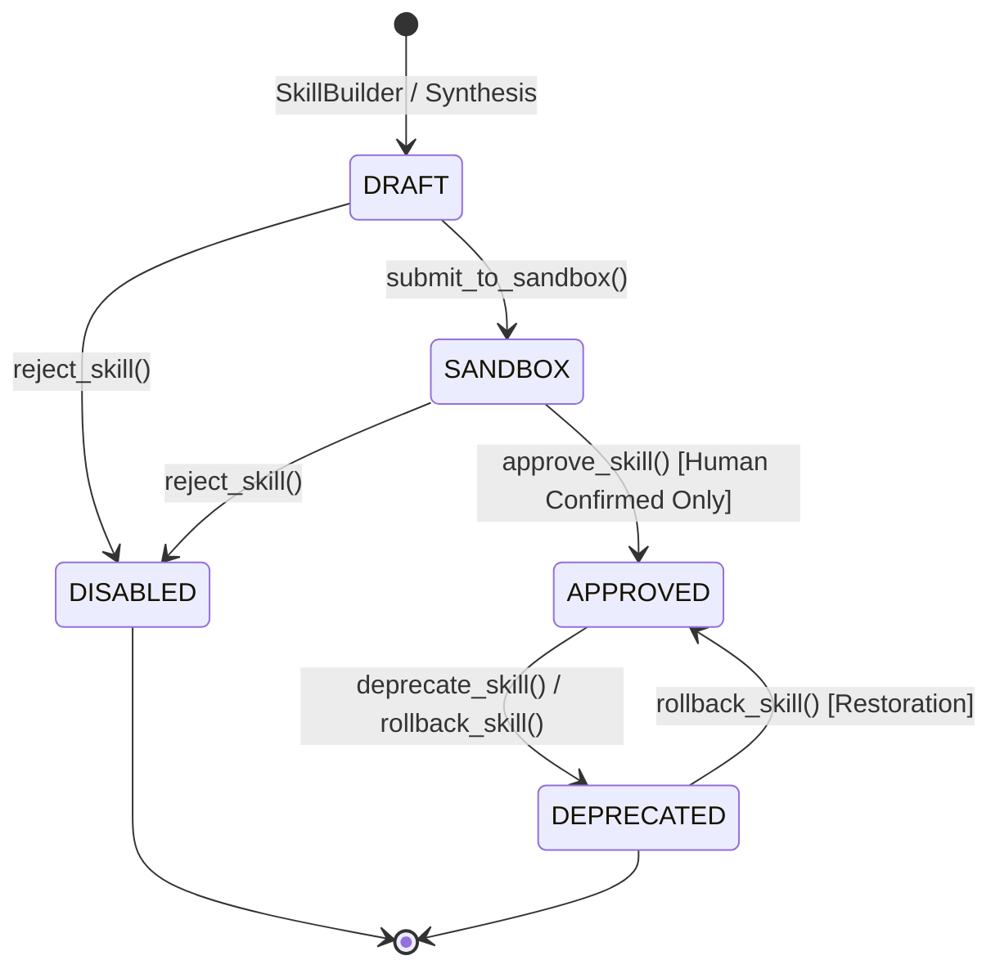

# Skill Governance, Immutability & Lifecycle Security

## 1. Principles of Skill Governance

As LibreSprite Game MCP evolves to autonomously propose and synthesize production workflows, strict security boundaries are enforced to prevent untested or hallucinated routines from affecting game assets.

Governance is anchored on three immutable tenets:
1. **Human Art Director & Tech Lead Supremacy**: No AI agent, automated pipeline, or system background job can approve a skill for production use.
2. **Approved Skill Immutability**: Once approved, a skill manifest is cryptographically and logically immutable. Any modification requires a new semantic version (`semver`).
3. **Sandbox Prerequisite**: A skill cannot transition directly from `DRAFT` to `APPROVED`. It must undergo deterministic verification in `SANDBOX` mode first.

---

## 2. Skill Lifecycle State Machine



### Transition Validation Rules

| Current Status | Target Status | Permitted Method | Prerequisites / Mandatory Conditions |
| :--- | :--- | :--- | :--- |
| `DRAFT` | `SANDBOX` | `submit_to_sandbox()` | Valid DAG workflow, allowlisted tools. |
| `DRAFT` | `APPROVED` | **FORBIDDEN** | Raises `InvalidStateTransitionError`. Must pass sandbox first. |
| `SANDBOX` | `APPROVED` | `approve_skill()` | **1.** `human_confirmed=True`<br>**2.** Human reviewer identity (non-bot)<br>**3.** Comments $\ge 10$ characters |
| `APPROVED` | `DEPRECATED` | `deprecate_skill()` | Human reviewer justification. |
| `APPROVED` | Any Mutating Save | **FORBIDDEN** | Raises `ImmutableSkillError`. Semver bump required. |

---

## 3. Human Approval Enforcement

### 3.1 Autonomous Agent Rejection
To prevent LLM agents or autonomous loops from rubber-stamping candidate workflows, `SkillLifecycleManager.approve_skill()` strictly screens the reviewer string:

```python
AUTONOMOUS_REVIEWERS = {
    "system", "agent", "autonomous", "auto", "llm",
    "skill_builder", "evaluator", "orchestrator", "bot", "ai"
}
```

If the reviewer string matches any automated entity pattern, an `AutonomousApprovalError` is raised immediately:
> `Autonomous approval rejected for skill '...' version '...'. Reviewer matches automated agent or system pattern. Human Art Director or Technical Lead approval is strictly mandatory.`

### 3.2 Explicit Human Confirmation Token
Approvals require passing `human_confirmed=True`. If omitted or set to `False`, approval is aborted.

### 3.3 Justification Audit Trail
Human approvals mandate detailed review comments (minimum 10 characters). Each transition logs an immutable entry in the `skill_approvals` audit table:
- `id`: Unique UUID
- `skill_id`: Skill identifier
- `skill_version`: Version string
- `action`: `APPROVED`, `REJECTED`, or `DEPRECATED`
- `reviewer`: Authenticated reviewer name
- `comments`: Human justification notes
- `timestamp`: UTC ISO timestamp

---

## 4. Immutability & Semantic Versioning

### 4.1 Strict Write Protection
In `SkillRepository.save_skill_definition()`:
```python
existing = self.get_skill_version(skill.skill_id, skill.version)
if existing and existing.status == SkillStatus.APPROVED:
    raise ImmutableSkillError(
        f"Cannot modify skill '{skill.skill_id}' version '{skill.version}'. "
        "Approved skills are immutable. Bump version (semver) to propose modifications."
    )
```

### 4.2 Atomic Filesystem Manifest Writes
To prevent corrupted or half-written `skill.json` files during power failure or unexpected process termination, manifest export uses atomic filesystem replacements:
```python
tmp_path = skill_file.with_suffix(".tmp")
with open(tmp_path, "w", encoding="utf-8") as f:
    json.dump(skill.model_dump(mode="json"), f, indent=2)
os.replace(tmp_path, skill_file)
```
`os.replace` guarantees an atomic rename on POSIX and Windows filesystems.

---

## 5. Rollback Semantics

When a production skill version demonstrates defects or regressions in live game builds:
1. `rollback_skill(skill_id, from_version, to_version, reviewer, comments)` is called.
2. `from_version` is automatically transitioned to `DEPRECATED` with an audit record documenting the rollback reason.
3. `to_version` is re-activated as `APPROVED` with an audit record indicating its restoration.
4. No historical records or telemetry are deleted; complete audit traceability is preserved.
